# 💬 Chats UI App — React-Native-Task-1


A modern, responsive chat list user interface built with React Native, Expo and TypeScript. The application recreates a given Figma-style design exactly, including the header, the online story chips, the recent chats list and the group chat card, using reusable components and React Native StyleSheets.

This project was built to practice React Native components, StyleSheet styling, reusable component design, screen responsiveness and hover/press interactivity. It is a UI-only challenge, so nothing is functional apart from the visual feedback on buttons and chat rows.

## 🚀 Getting Started

Clone the repository

```bash
git clone https://github.com/Samukelokhathi/Charity-UI.git
```

Navigate into the project

```bash
cd Charity-UI
```

Install dependencies

```bash
npm install
```

Start the Expo development server

```bash
npx expo start
```

Then run the app:

* 📱 **Phone:** install **Expo Go**, make sure your phone and computer are on the **same Wi-Fi**, and scan the QR code
* 🌐 **Web:** press `w` in the terminal to open `http://localhost:8081`

> If Expo Go says you are signed in as a different account than Expo CLI, log out in Expo Go or run `npx expo login` with the same account.

## 🆕 Creating a React Native Project From Scratch

These are the commands used to create the project (from the course lessons).

Create a new Expo app

```bash
npx create-expo-app@latest Charity-UI
```

> `npx` downloads and runs the tool from the registry, so nothing has to be installed globally. `@latest` uses the newest version of the tool, and `Charity-UI` is the project name.

Move into the project folder

```bash
cd Charity-UI
```

List the files and folders in the project

```bash
dir
```

Open the project in VS Code

```bash
code .
```

## ✨ Features

* 🎨 Pixel-faithful recreation of the Chats screen design
* 🔙 Header with back button, title and profile button with unread badge
* 🟢 Story chips row with online status indicators
* 💬 Recent chat list with avatars, previews, time stamps and unread badges
* 🎤 Voice message and "typing..." message states
* 👥 Group chat card with an avatar cluster
* 🖱️ Hover and press colour changes on buttons, chips and chat rows
* ♻️ Reusable components used across the whole screen
* 📱 Responsive layout for different mobile screen sizes
* 🗂️ Realistic mock chat data kept separate from the UI

## 🛠️ Technologies Used

* React Native
* Expo
* Expo Router
* TypeScript
* React Native StyleSheet
* React Native Safe Area Context
* Expo Go (testing on a real device)
* EAS CLI (building the APK)
* Figma (design and preview)
* Git and GitHub

## 📚 What I Learned

During this project I practiced:

* Creating a project with `create-expo-app` and understanding the generated files
* Understanding `app.json`, `package.json` and `tsconfig.json`
* Building a mobile UI from a design using React Native
* Styling with StyleSheet (`StyleSheet.create`), flexbox and spacing
* Creating reusable components such as Avatar, Badge, IconButton and ChatListItem
* Passing data through props and rendering lists with `map`
* Using `Pressable` to create hover and press states
* Building layouts that adapt to different screen sizes
* Separating the theme, data, components and screens
* Using Expo Router and Expo Go to test on a real device
* Building the app as an APK using EAS Build
* Planning work with Scrum in ClickUp and designing previews in Figma
* Using Git branches and GitHub to manage each step of the project

## 🧩 Reusable Components

| Component | File | Purpose |
| --- | --- | --- |
| `Avatar` | `avatar.tsx` | Circle avatar with initial and optional online dot |
| `Badge` | `badge.tsx` | Small circular unread counter |
| `IconButton` | `iconButton.tsx` | Round button with hover/press state and optional badge |
| `StoryChip` | `storyChip.tsx` | Pill with avatar and name for the top row |
| `ChatListItem` | `chatListItem.tsx` | One chat row: avatar, name, preview, time and badge |
| `GroupAvatarCluster` | `groupAvatarCluster.tsx` | Group avatar with several small avatars and a "+6" bubble |
| `SectionCard` | `sectionCard.tsx` | Rounded card with a section title |
| `ChatsHeader` | `chatsHeader.tsx` | Header card with buttons and story chips |

## 📁 Project Structure

```text
Directory structure:
└── samukelokhathi-charity-ui/
    ├── README.md
    ├── AGENTS.md
    ├── app.json
    ├── LICENSE
    ├── package.json
    ├── tsconfig.json
    ├── assets/
    │   └── expo.icon/
    │       └── icon.json
    ├── scripts/
    │   └── reset-project.js
    ├── src/
    │   ├── global.css
    │   ├── app/
    │   │   ├── _layout.tsx
    │   │   ├── explore.tsx
    │   │   └── index.tsx
    │   ├── components/
    │   │   ├── animated-icon.module.css
    │   │   ├── animated-icon.tsx
    │   │   ├── animated-icon.web.tsx
    │   │   ├── app-tabs.tsx
    │   │   ├── app-tabs.web.tsx
    │   │   ├── external-link.tsx
    │   │   ├── hint-row.tsx
    │   │   ├── themed-text.tsx
    │   │   ├── themed-view.tsx
    │   │   ├── web-badge.tsx
    │   │   ├── base/
    │   │   │   ├── avatar.tsx
    │   │   │   ├── badge.tsx
    │   │   │   └── iconButton.tsx
    │   │   ├── composite/
    │   │   │   ├── chatListItem.tsx
    │   │   │   ├── chatsHeader.tsx
    │   │   │   ├── groupAvatarCluster.tsx
    │   │   │   ├── sectionCard.tsx
    │   │   │   └── storyChip.tsx
    │   │   └── ui/
    │   │       └── collapsible.tsx
    │   ├── constants/
    │   │   └── theme.ts
    │   ├── data/
    │   │   └── chats.ts
    │   ├── hooks/
    │   │   ├── use-color-scheme.ts
    │   │   ├── use-color-scheme.web.ts
    │   │   └── use-theme.ts
    │   └── theme/
    │       └── index.ts
    └── .claude/
        └── settings.json

```

### What each folder does

* `src/app/` — Expo Router screens: `index.tsx` is the Chats screen, `explore.tsx` is the starter Explore screen, `_layout.tsx` sets up the tabs
* `src/components/` — reusable UI pieces. Files ending in `.web.tsx` are used only on the web version
* `src/components/ui/` — small starter UI helpers such as the collapsible
* `src/constants/theme.ts` — starter theme colours, fonts and layout values
* `src/theme/index.ts` — the chat palette used by the Chats UI
* `src/data/chats.ts` — sample stories and chat messages
* `src/hooks/` — theme and colour-scheme hooks (light/dark)
* `scripts/` — the `reset-project.js` script from the Expo template
* `assets/` — icons and images

## 🗺️ Architecture

How the screens, components, data and theme connect:

```mermaid
flowchart TD

subgraph group_routing["App Shell"]
  node_layout["Tab layout<br/>[_layout.tsx]"]
  node_tabs["Tab bar<br/>[app-tabs.tsx]"]
  node_animatedicon["Animated icon<br/>[animated-icon.tsx]"]
end

subgraph group_chat["Chat UI"]
  node_home["Chats screen<br/>[index.tsx]"]
  node_chatdata["Sample chat data<br/>[chats.ts]"]
  node_header["Chats header<br/>[chatsHeader.tsx]"]
  node_chatrow["Chat list item<br/>[chatListItem.tsx]"]
  node_avatar["Avatar<br/>[avatar.tsx]"]
  node_groupavatar["Group avatar cluster"]
  node_section["Section card<br/>[sectionCard.tsx]"]
  node_story["Story chip<br/>[storyChip.tsx]"]
end

subgraph group_starter["Explore Examples"]
  node_explore["Explore screen<br/>[explore.tsx]"]
  node_collapsible["Collapsible example<br/>[collapsible.tsx]"]
  node_externallink["External link<br/>[external-link.tsx]"]
  node_webbadge["Web badge<br/>[web-badge.tsx]"]
end

subgraph group_shared["Shared UI and Theme"]
  node_badge["Unread badge<br/>[badge.tsx]"]
  node_themedtext["Themed text<br/>[themed-text.tsx]"]
  node_themedview["Themed view<br/>[themed-view.tsx]"]
  node_themehook["Theme hook<br/>[use-theme.ts]"]
  node_colorscheme["Color scheme hook"]
  node_themeconstants["Theme constants<br/>[theme.ts]"]
  node_chatcolors["Chat palette<br/>[index.ts]"]
end

node_user(("App user"))

node_user -->|"opens app"| node_layout
node_layout -->|"sets up tabs"| node_tabs
node_layout -->|"renders"| node_animatedicon
node_home -->|"reads sample data"| node_chatdata
node_home -->|"renders"| node_header
node_home -->|"renders"| node_section
node_home -->|"renders"| node_chatrow
node_home -->|"renders"| node_avatar
node_home -->|"renders"| node_groupavatar
node_home -->|"uses colors"| node_chatcolors
node_chatrow -->|"renders"| node_badge
node_groupavatar -->|"renders"| node_avatar
node_header -->|"reads stories"| node_chatdata
node_header -->|"renders"| node_story
node_story -->|"renders"| node_avatar
node_chatrow -->|"uses colors"| node_chatcolors
node_avatar -->|"uses colors"| node_chatcolors
node_section -->|"uses colors"| node_chatcolors
node_tabs -->|"uses constants"| node_themeconstants
node_explore -->|"renders"| node_collapsible
node_explore -->|"renders"| node_externallink
node_explore -->|"renders"| node_themedtext
node_explore -->|"renders"| node_themedview
node_explore -->|"renders"| node_webbadge
node_explore -->|"reads theme"| node_themehook
node_collapsible -->|"renders"| node_themedtext
node_collapsible -->|"renders"| node_themedview
node_collapsible -->|"reads theme"| node_themehook
node_themedtext -->|"reads theme"| node_themehook
node_themedview -->|"reads theme"| node_themehook
node_themehook -->|"reads scheme"| node_colorscheme
node_themehook -->|"reads colors"| node_themeconstants
node_themedtext -->|"uses fonts"| node_themeconstants
node_themedview -->|"uses color keys"| node_themeconstants
node_explore -->|"uses layout values"| node_themeconstants

classDef toneBlue fill:#dbeafe,stroke:#2563eb,stroke-width:1.5px,color:#172554
classDef toneAmber fill:#fef3c7,stroke:#d97706,stroke-width:1.5px,color:#78350f
classDef toneMint fill:#dcfce7,stroke:#16a34a,stroke-width:1.5px,color:#14532d
classDef toneRose fill:#ffe4e6,stroke:#e11d48,stroke-width:1.5px,color:#881337
class node_layout,node_tabs,node_animatedicon,node_user toneBlue
class node_home,node_chatdata,node_header,node_chatrow,node_avatar,node_groupavatar,node_section,node_story toneAmber
class node_explore,node_collapsible,node_externallink,node_webbadge toneMint
class node_badge,node_themedtext,node_themedview,node_themehook,node_colorscheme,node_themeconstants,node_chatcolors toneRose
```



## 🔧 Run Application

Start the development server (shows the QR code)

```bash
npx expo start
```

Same as above, using the `start` script in `package.json`

```bash
npm start
```

Start with a cleared cache

```bash
npx expo start -c
```

Start in tunnel mode (if the phone cannot connect over Wi-Fi)

```bash
npx expo start --tunnel
```

Run directly on a platform

```bash
npm run android
npm run ios
npm run web
```

Other scripts

```bash
npm test
npm run lint
npm run reset-project
```

> ⚠️ `npm run reset-project` moves the template code into a new folder and rewrites the starter layout. Only use it for a fresh start.

### ⌨️ Keyboard shortcuts in the Expo terminal

Click inside the terminal first, otherwise the key is typed into your code editor.

| Key | Action |
| --- | --- |
| `w` | Open the app in the web browser |
| `a` | Open on an Android emulator |
| `i` | Open on an iOS simulator |
| `c` | Clear the screen and show the QR code again |
| `m` | Open the developer menu on the device |
| `Ctrl + C` | Stop the server |

### 📱 Running on a phone with Expo Go

1. Install **Expo Go** from the Play Store or App Store (update it if it is old).
2. Connect the phone and the computer to the **same Wi-Fi network**.
3. Run `npx expo start` and scan the QR code.
4. Edit the code and save. The app updates on the phone and the browser at the same time.

If you see "Something went wrong", the phone cannot find the Metro server. Check that both devices are on the same network first.

## 📦 Build the App as an APK

The app is built online with **EAS Build** so it can be installed without being connected to the same network.

Install the EAS CLI globally (`-g` is short for `--global`, `i` is short for `install`)

```bash
npm install -g eas-cli
```

Log in to your Expo account

```bash
eas login
```

Install Expo Updates

```bash
npx expo install expo-updates
```

Configure EAS Update

```bash
eas update:configure
```

Configure EAS Build (choose Android). This creates the `eas.json` file, which must be added to Git

```bash
eas build:configure
```

Create the Android build with the preview profile (run this inside the project folder)

```bash
eas build --platform android --profile preview
```

> When asked to generate a new Android keystore, answer **yes**. When asked for the project name, accept the default. The build runs on Expo's servers and can take from a few minutes to a couple of hours.

Install the APK on a phone:

1. Open the Expo website on the phone and open your project's build.
2. Tap **Install** under *Build artifact* to download the APK.
3. Open the download and choose **Package installer**, then tap **Install**.
4. Upload the APK to Google Drive and share the link in the section below.

## 🔗 Documents Links

* 🔗 **Google Drive Build (APK):https://drive.google.com/file/d/1Fb2smboBgg8c1o_TCzLcbjFdRB2uPrVG/view?usp=drive_link
* 🔗 **GitHub Repository:** https://github.com/Samukelokhathi/Charity-UI
* 🔗 **Figma Preview:** https://www.figma.com/design/4Q3GyZ5mQdmtpnVnzc2MCf
